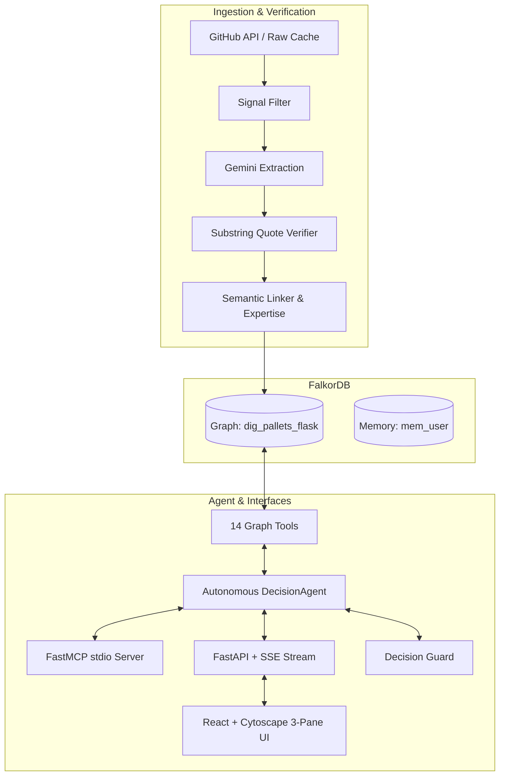

# Decision Archaeologist

> **Graph-native context layer & Company Brain for repository decision history.**  
> *Built for Graph Hacks Track 3 (Company Brain) powered by **FalkorDB** and **Google Gemini**.*

---

## Overview

Codebases are graveyards of forgotten context. Git preserves *what* code changed, but the critical reasoning—*why* choices were made, *who* debated them, and *what was tried and reversed*—remains buried across thousands of closed GitHub issues, PRs, and comments.

**Decision Archaeologist** transforms this raw unstructured history into an active, verifiable knowledge brain in **FalkorDB**:
- **Anti-Hallucination Provenance**: Every factual claim is verified against verbatim source quotes; hallucinated claims are blocked by an automated verifier.
- **Bi-temporal Lineage**: Tracks `SUPERSEDES` and `REVERSES` relationships across version milestones.
- **Decision Guard**: Proactively flags planned changes or PRs that conflict with past decisions in <50ms.
- **Expertise Recency Decay**: Identifies true module owners based on authored PRs and reviews decayed by time.
- **Cross-Session Memory Graph**: Remembers past user inquiries in dedicated FalkorDB memory graphs (`mem_<user_id>`).
- **Standard FastMCP Server**: Exposes 14 graph tools over stdio to Claude Desktop, IDEs, and AI coding agents.



---

## 5-Command Quickstart

Get the entire system running locally with live data:

```bash
# 1. Start FalkorDB container
docker compose up -d falkordb

# 2. Install Python backend dependencies
python -m venv .venv && source .venv/bin/activate
pip install -e .

# 3. Seed demo graph & warm up cache (or ingest live: dig ingest --repo pallets/flask)
./scripts/demo_reset.sh

# 4. Start FastAPI backend (port 8000)
dig serve

# 5. Start Frontend UI (port 5173) in another terminal
cd frontend && npm install && npm run dev
```

Visit **`http://localhost:5173`** to interact with the Cytoscape canvas, chat agent, and Decision Guard.

---

## Tool Catalogue (Exposed via Agent & FastMCP Server)

All 14 tools are defined once with Pydantic typing and shared between the agent loop and MCP server:

| Tool | Parameters | Purpose |
|---|---|---|
| `search_decisions` | `query`, `module?`, `status?`, `type?`, `limit` | Full-text & filtered search over historical decisions |
| `get_decision` | `decision_id` | 1-hop expansion: metadata, deciders, quotes, and impact |
| `trace_to_source` | `decision_id` | Provenance trace: verbatim quotes, GitHub URLs, and authors |
| `decision_lineage` | `decision_id` | Multi-hop traversal of `SUPERSEDES` and `REVERSES` chains |
| `who_knows` | `module`, `limit` | Recency-decayed expertise scores for module maintainers |
| `who_decided` | `decision_id` | Identifies authors and reviewers who made the choice |
| `impact_of` | `decision_id` | Blast radius: affected modules, files, downstream decisions, releases |
| `find_path` | `a_id`, `b_id` | Shortest relationship path between any two graph entities |
| `central_people` | `scope`, `limit` | PageRank centrality ranking across decisions & modules |
| `recent_changes` | `since`, `limit` | Temporal filter of decisions modified since an ISO date |
| `check_proposal` | `description`, `paths[]` | **Decision Guard**: flags conflicts with historical choices |
| `draft_adr` | `decision_id` | Generates a Markdown Architectural Decision Record |
| `recall` | `topic`, `limit` | Recalls past findings from FalkorDB user memory graph |
| `pin` | `decision_id`, `note` | Pins a decision to user memory for future turns |

To launch the MCP server over stdio for Claude Desktop or Cursor:
```bash
python -m dig.mcp_server
```

---

## Provenance Enforcement & Anti-Hallucination

1. **Extraction Verification**: During extraction (`dig extract`), every quote is matched as an exact substring against normalized thread markdown. Hallucinated quotes are dropped.
2. **Turn Marker Parsing**: Agent answers must cite inline markers `[[ev:ID]]` referencing evidence IDs returned by tools in *that specific turn*.
3. **One-Turn Repair**: If an unrecognized evidence ID or uncited factual claim is detected, `CitationVerifier` executes a repair turn instructing the model to ground its claims or remove them.
4. **Trust Badge**: Verified markers convert to clickable `[1]`, `[2]` citation chips linking to the real GitHub comment. The frontend renders an official verification badge: **"All citations verified against graph"**.

---

## Evaluation (`eval/REPORT.md`)

Run the 12 canonical questions (History, Ownership, Impact, Reversal, Guard):
```bash
python eval/run_eval.py
```

`eval/REPORT.md` states the **agent mode** and the **graph size** it measured, so numbers cannot be mistaken for something they are not:

- **With `GEMINI_API_KEY` set** the agent calls a live model against whatever graph is loaded. This is the real benchmark: retrieval hit rate, citation validity after the repair turn, tool rounds and latency.
- **Without a key** the runner switches to the offline simulator (scripted answers keyed to the 22-node seed graph). The report is then labelled as such. It is a regression check for tool wiring, the citation verifier, the repair turn and guard queries, not a measure of answer quality.

The committed report was generated in offline mode. Re-run with a key against your full `pallets/flask` graph and commit the result before quoting benchmark numbers.

---

## Configuration

Copy `.env.example` to `.env`.

| Variable | Purpose |
|---|---|
| `GITHUB_TOKEN` | GitHub API access for `dig ingest` |
| `GEMINI_API_KEY` (or `GOOGLE_API_KEY`) | Live LLM for extraction, linking and the agent |
| `DIG_OFFLINE=1` | Opt in to canned demo answers from the seed graph. **Off by default**: with no key and no opt-in, `/ask` returns a clear error instead of scripted answers. |
| `CORS_ORIGINS` | Comma-separated browser origins allowed to call the API (default: the Vite dev server) |

`GET /health` reports `llm_mode` (`live`, `offline` or `no_key`), and the UI shows a banner when answers are not from a live model.

---

## REST & SSE API Reference

The backend runs at `http://localhost:8000`:

### Health Check
```bash
curl -s http://localhost:8000/health | jq
```
```json
{
  "ok": true,
  "graph": "dig_pallets_flask",
  "counts": {
    "Decision": 3,
    "Evidence": 3,
    "Person": 4,
    "Issue": 32,
    "PullRequest": 48
  },
  "last_synced": "2026-10-16T12:00:00Z",
  "llm_mode": "live"
}
```

### Ask Agent via Server-Sent Events (SSE)
```bash
curl -N -X POST http://localhost:8000/ask \
  -H "Content-Type: application/json" \
  -d '{"question": "Why was Python 3.6 dropped?"}'
```

### Check Proposal with Decision Guard
```bash
curl -s -X POST http://localhost:8000/guard \
  -H "Content-Type: application/json" \
  -d '{"description": "Restore Python 3.6 compatibility helpers", "paths": ["src/flask/compat.py"]}' | jq
```

### Time Machine, knowledge-risk map and PR Guard
```bash
# Date bounds and decided/replaced events for the slider
curl -s http://localhost:8000/timeline/range | jq
# What was decided, and what was already replaced, by the end of a day
curl -s "http://localhost:8000/timeline/snapshot?date=2021-06-01T23:59:59Z" | jq
# Modules ranked by fragile knowledge (few, concentrated or inactive experts)
curl -s "http://localhost:8000/risk/modules?window_days=365" | jq
# Check a GitHub PR against past decisions (needs outbound access to api.github.com)
curl -s -X POST http://localhost:8000/guard/pr \
  -H "Content-Type: application/json" \
  -d '{"url": "https://github.com/pallets/flask/pull/5000"}' | jq
```
Notes: `/risk/modules` measures "active" relative to the newest activity in the graph (reported as `as_of_source`), so an old snapshot is not all marked inactive. `/guard/pr` only accepts `https://github.com/<owner>/<repo>/pull/<n>` links, never follows redirects, and reports which judge ran (`guard.judge` = `llm`, `mixed` or `heuristic`). The keyword heuristic is tuned to the Flask demo and is not a general conflict detector.

---

## Web UI (Strata)

`cd frontend && npm run dev`, then open http://localhost:5173.

| Route | Page |
|---|---|
| `#/` | Landing page: scroll-driven "dig" animation, how it works, live graph counts |
| `#/app` | Workspace: chat, graph canvas, evidence, Decision Guard |
| `#/time` | Time Machine: slider and play button over `/timeline/*`; deep link with `#/time?date=YYYY-MM-DD` |
| `#/guard` | PR Guard: paste a PR link, see conflicts, quotes, judge badge and suggested reviewers |
| `#/risk` | Knowledge-risk map: module heat grid with expert detail |

`Cmd/Ctrl+K` opens a command palette (pages, actions, jump to a decision) and the **Tour** button walks through the four app pages. The top bar always says where data comes from: `LIVE`, `OFFLINE DEMO MODE`, `NO API KEY`, `BACKEND OFFLINE` or `DEMO DATA` (recorded samples; switch with the top-bar button or `VITE_MOCK=1`). Pages never fall back to demo data silently.

---

## Testing

Run unit and integration test suites:
```bash
# Run all backend unit tests (54 passing tests)
pytest -v

# Run Python linter
ruff check .

# Run Frontend build and lint
cd frontend && npm run lint && npm run build
```

---

## License
MIT License. Built for Graph Hacks 2026.
