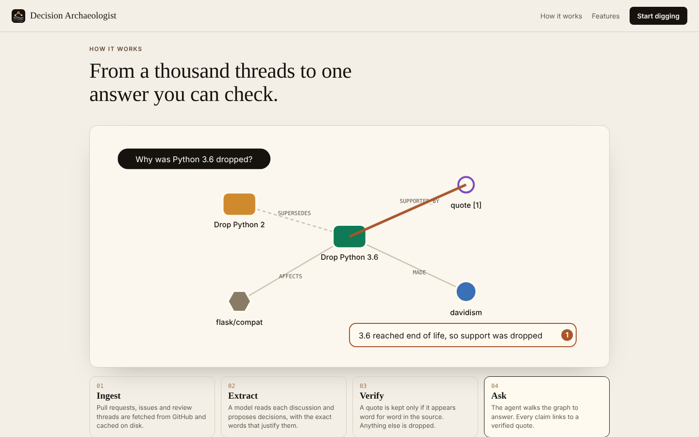
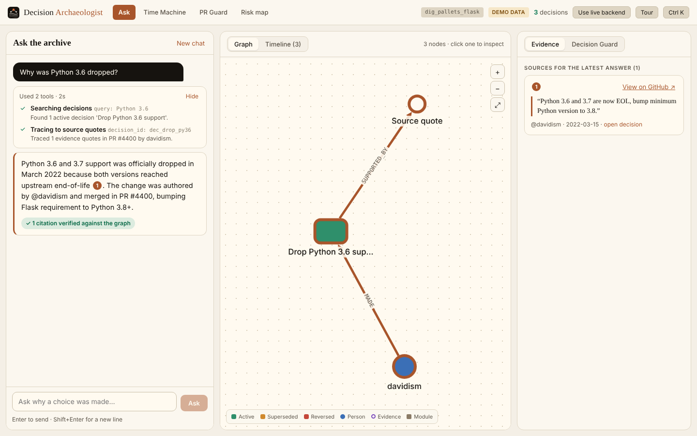
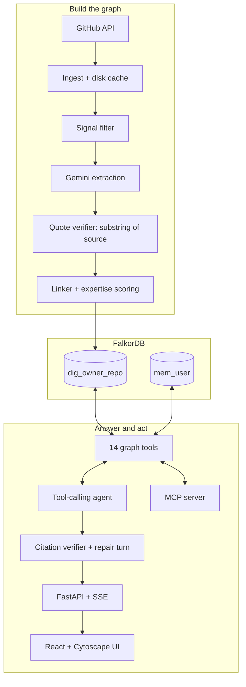
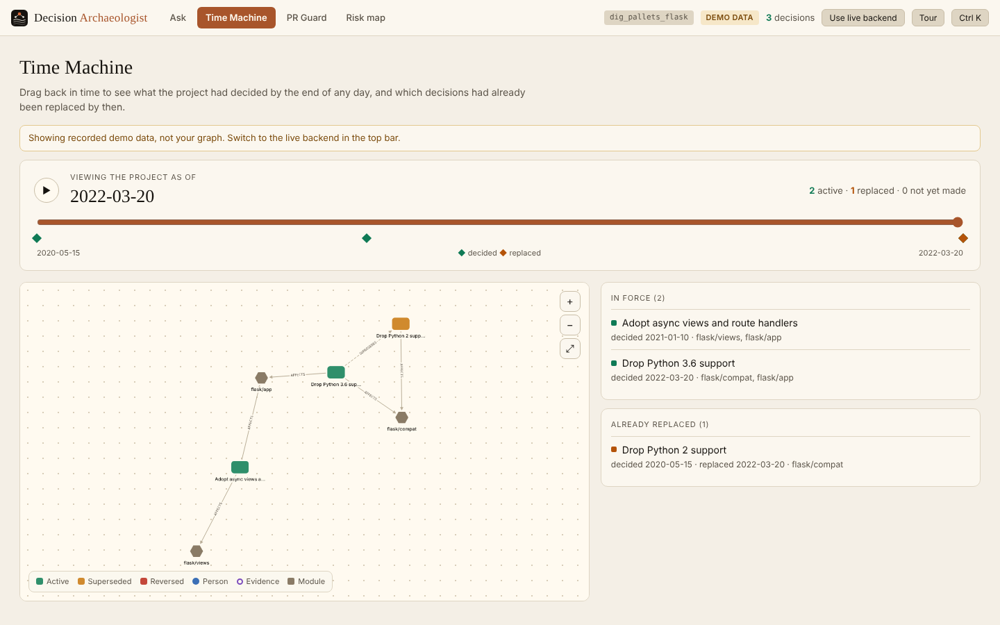
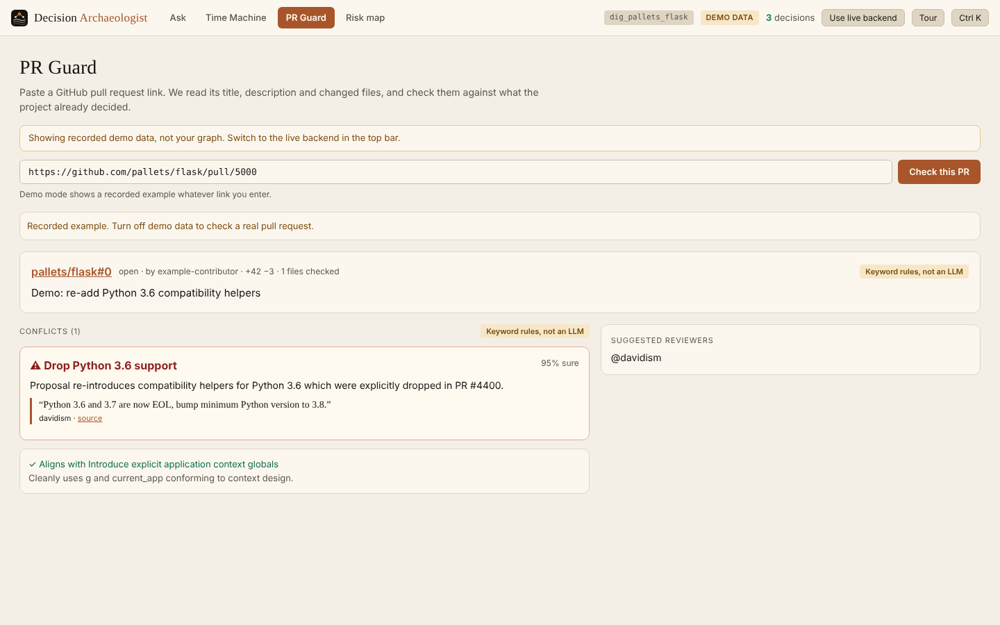
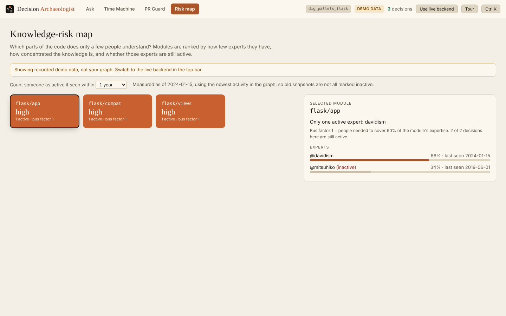

<p align="center">
  
</p>

<h1 align="center">Decision Archaeologist</h1>

<p align="center">
  <b>Ask why your project made its choices, and get answers traced to quotes that were verified word for word.</b><br>
  A graph-native "company brain" for the decision history of an open-source repository.<br>
  Built for <b>Graph Hacks</b> (FalkorDB), Track 3: Company Brain.
</p>

<p align="center">
  
</p>

---

## Contents

1. [The problem](#the-problem)
2. [What it does](#what-it-does)
3. [How it works](#how-it-works)
4. [Architecture](#architecture)
5. [Quickstart](#quickstart)
6. [Track your own repository](#track-your-own-repository)
7. [The web app](#the-web-app)
8. [The agent and its tools](#the-agent-and-its-tools)
9. [Why you can trust an answer](#why-you-can-trust-an-answer)
10. [Graph model](#graph-model)
11. [API reference](#api-reference)
12. [MCP server](#mcp-server)
13. [Evaluation](#evaluation)
14. [Configuration](#configuration)
15. [Project layout](#project-layout)
16. [Testing and quality checks](#testing-and-quality-checks)
17. [Troubleshooting](#troubleshooting)
18. [Limitations and roadmap](#limitations-and-roadmap)
19. [More documentation](#more-documentation)

---

## The problem

Git records *what* changed. The reasoning behind it (why a choice was made, who argued for it, what was tried and reversed) is scattered across thousands of closed issues, pull requests and review comments.

The cost is familiar. New contributors repeat arguments that were settled years ago. Reviewers cannot tell whether a proposal contradicts an earlier decision. When the one person who understood a module leaves, the knowledge leaves with them.

Plain chat over a repository does not fix this, because a model that answers from memory or loose retrieval can state a reason that sounds right and was never said.

## What it does

Decision Archaeologist turns a repository's discussion history into a **FalkorDB graph where decisions are first-class nodes**, each tied to the exact quotes that justify it. An agent then answers questions by walking that graph. It cites only quotes it has verified.

| Feature | What you get |
|---|---|
| **Ask** | Chat with the archive. Watch each tool step as it runs, see the path light up on an animated graph, and click any citation to read the verified quote and open the real GitHub thread. |
| **Time Machine** | Drag a date slider to see which decisions were in force on any day, and which had already been replaced. |
| **PR Guard** | Paste a GitHub pull request link. It checks the PR against past decisions, shows conflicts with their source quotes, names which judge ran, and suggests reviewers. |
| **Decision Guard** | Type a proposed change (and optional file paths) and see which past decisions it contradicts. |
| **Knowledge-risk map** | Modules ranked by how fragile their knowledge is: few experts, knowledge concentrated in one person, or experts who are no longer active. |
| **Lineage and impact** | Follow `SUPERSEDES` and `REVERSES` chains, and see the blast radius of a decision across modules, files and releases. |
| **Cross-session memory** | Findings and pins are stored per user in their own graph (`mem_<user>`) and recalled in later sessions. |
| **MCP server** | The same 14 graph tools, exposed over stdio to Claude Desktop, Cursor or any MCP client. |
| **Guided tour and `Ctrl/Cmd+K`** | A four-stop tour of the app and a command palette to jump between pages and decisions. |

<p align="center">
  <br>
  <sub>Ask: the agent's tool steps, a verified answer with a numbered citation, and the graph path it walked. (Recorded demo data.)</sub>
</p>

## How it works

```
GitHub ──► ingest ──► filter ──► extract ──► verify ──► link ──► score ──► FalkorDB ──► tools ──► agent ──► UI / MCP
```

1. **Ingest** (`dig ingest`). Pull issues, pull requests, reviews, comments, changed files and releases from the GitHub REST API. Every response is cached on disk, keyed by content, so re-runs are free and demos work offline.
2. **Filter** (`extract/signals.py`). A cheap keyword and label score picks the threads that probably contain a decision (deprecation, removal, "we decided", revert, breaking change). This keeps the LLM bill small.
3. **Extract** (`dig extract`). Gemini reads each candidate thread and proposes decisions as typed JSON: title, summary, type, status, and the exact quotes that support it. Malformed JSON is retried once, then skipped and logged.
4. **Verify** (`extract/verify.py`). A quote is kept **only if its whitespace-normalised text is a substring of the source it claims to come from**. Any other quote is dropped, and a decision left with no quote is dropped with it.
5. **Link and score** (`dig link`, `dig score`). Decisions are linked to each other (`SUPERSEDES`, `REVERSES`, `DEPENDS_ON`, `CONFLICTS_WITH`), and each person gets a recency-decayed expertise score per module from the work they authored, reviewed and commented on.
6. **Load** (`graph/loader.py`). Everything is written to FalkorDB with `MERGE` on stable keys, so any step can be re-run without creating duplicates.
7. **Answer.** At question time the agent can only act through graph tools. A verifier then checks every citation before the answer is shown.

## Architecture



**Stack.** Python 3.11+, FastAPI, pydantic v2, httpx, the `falkordb` client, the `google-genai` SDK (Gemini), the `mcp` SDK, networkx and scipy for graph algorithms, typer for the CLI. Frontend: Vite, React 19, TypeScript, Cytoscape.js.

**Design rules the code follows** (see `CLAUDE.md`):

- All Cypher is parameterised. User and LLM text is never interpolated into a query.
- Loads are idempotent (`MERGE`). One graph per project: `dig_<owner>_<repo>`.
- A graph algorithm is used only if FalkorDB provides it. Otherwise it runs in Python (networkx) over an exported subgraph (for example PageRank in `central_people`).
- Fetched issue and PR text is treated as untrusted data and delimited in prompts. The model is told never to follow instructions found in it.
- Secrets come only from the environment and are never logged or committed.

## Quickstart

You need Docker, Python 3.11 or newer, and a recent Node.js.

### Option A: run the seeded demo (no API keys)

```bash
# 1. Start FalkorDB (port 6379, browser UI on 3000)
docker compose up -d falkordb

# 2. Install the backend
python -m venv .venv && source .venv/bin/activate
pip install -e ".[dev]"

# 3. Seed the demo graph. With no Gemini key this runs in OFFLINE DEMO MODE (canned answers).
./scripts/demo_reset.sh

# 4. Start the API on :8000 (add DIG_OFFLINE=1 if you have no key)
DIG_OFFLINE=1 dig serve

# 5. Start the UI on :5173, in another terminal
cd frontend && npm install && npm run dev
```

Open <http://localhost:5173>. The top bar says where answers come from: `LIVE`, `OFFLINE DEMO MODE`, `NO API KEY`, `BACKEND OFFLINE` or `DEMO DATA`. Offline answers are canned replies keyed to the seed graph, and the UI labels them as such.

A fast way to check it works: ask **"Why was Python 3.6 dropped?"**. You should see two tool steps, a one-citation answer quoting the end-of-life message, and a green "1 citation verified against the graph" badge.

### Option B: run on real data

```bash
cp .env.example .env     # then set GITHUB_TOKEN and GEMINI_API_KEY
dig ingest --repo pallets/flask --max-threads 1500
dig extract && dig link && dig score
dig serve
```

### Option C: a hosted front end with no backend

```bash
cd frontend && VITE_MOCK=1 npm run build   # static site in frontend/dist
```

This build uses recorded sample data and shows a `DEMO DATA` label throughout, so nobody mistakes it for a live graph.

## Track your own repository

The backend serves **one repository at a time**, chosen by `TARGET_REPO` in `.env` (default `pallets/flask`). Each repository gets its own graph, named from the repository (`owner/my-repo` becomes `dig_owner_my_repo`), so repositories never mix and you can switch back without re-ingesting.

```bash
# 1. Point at the repository
echo "TARGET_REPO=owner/my-repo" >> .env     # or edit the line in .env

# 2. Build its graph
dig ingest --repo owner/my-repo --max-threads 1500
dig extract --repo owner/my-repo
dig link && dig score

# 3. Serve it
dig serve
```

Keep it current with `dig sync --repo owner/my-repo`, which fetches only new activity. To compare two repositories side by side, run two backends on different ports with different `TARGET_REPO` values.

Two things to know. The PR Guard keyword rules are tuned for the Flask demo, so conflict detection on other projects is weaker unless an LLM key is set. And after building a new graph, check a decision you can verify on GitHub: ask about it and confirm the cited quote appears in the real thread.

## The web app

`cd frontend && npm run dev`, then open <http://localhost:5173>. The whole interface shares one cream-and-ink palette, shows skeleton or typing loaders while data loads, and respects `prefers-reduced-motion`.

| Route | Page |
|---|---|
| `#/` | Landing page: scroll-driven "dig" animation, animated how-it-works walkthrough, live graph counts |
| `#/app` | **Ask**: chat with live tool steps, animated graph path, timeline, evidence and Decision Guard |
| `#/time` | **Time Machine**: slider and play button over `/timeline/*`. Deep link with `#/time?date=YYYY-MM-DD` |
| `#/guard` | **PR Guard**: paste a PR link and see conflicts, quotes, the judge badge and suggested reviewers |
| `#/risk` | **Knowledge-risk map**: module heat grid with expert detail |

<table>
  <tr>
    <td width="50%"><br><sub>Time Machine: what was in force on 2022-03-20, and what had already been replaced.</sub></td>
    <td width="50%"><br><sub>PR Guard: a conflict with the quote that justifies it. The badge says keyword rules ran, not an LLM.</sub></td>
  </tr>
  <tr>
    <td colspan="2"><br><sub>Knowledge-risk map: modules ranked by how few active experts they have.</sub></td>
  </tr>
</table>

Details worth knowing:

- **The Ask page types out only the verified answer.** The model's draft is never streamed. If verification fails once, the agent gets one repair turn before anything is shown.
- **The badge reflects real counts.** Green means at least one citation verified and none invalid. Amber means "No sources cited". Red means an invalid citation. Canned offline answers carry their own label.
- **Pages never fall back to demo data silently.** Demo data appears only when you choose it (top-bar button or `VITE_MOCK=1`) and is always labelled.
- **A bad payload cannot blank the page.** Each page sits inside an error boundary, and API responses are normalised before they reach components.

## The agent and its tools

The agent is a tool-calling loop on Gemini. It may not answer from memory: if it replies without calling a tool, it is pushed back once. It may use up to 8 rounds. Each LLM call has a 90 second timeout, and transient 503 and 429 errors are retried with fallback to alternative models.

All 14 tools are defined once with typed parameters and shared by the agent and the MCP server. Every tool that touches the graph also returns `graph_elements` (the nodes and edges it touched), which is what lights up the path in the UI.

| Tool | Parameters | Purpose |
|---|---|---|
| `search_decisions` | `query`, `module?`, `status?`, `type?`, `limit` | Ranked search over decisions. Version numbers are kept whole, so "3.6" never matches "2". |
| `get_decision` | `decision_id` | One-hop view: metadata, deciders, quotes and impact |
| `trace_to_source` | `decision_id` | Provenance: verbatim quotes, GitHub URLs and authors |
| `decision_lineage` | `decision_id` | Multi-hop `SUPERSEDES` and `REVERSES` chains |
| `who_knows` | `module`, `limit` | Recency-decayed expertise for a module |
| `who_decided` | `decision_id` | Who proposed, approved and maintained the choice |
| `impact_of` | `decision_id` | Affected modules, files, downstream decisions and releases |
| `find_path` | `a_id`, `b_id` | Shortest relationship path between two entities |
| `central_people` | `scope`, `limit` | PageRank centrality over decisions and modules |
| `recent_changes` | `since`, `limit` | Decisions changed since an ISO date |
| `check_proposal` | `description`, `paths[]` | **Decision Guard**: conflicts with past decisions |
| `draft_adr` | `decision_id` | A Markdown Architecture Decision Record |
| `recall` | `topic`, `limit` | Past findings from the user's memory graph |
| `pin` | `decision_id`, `note` | Pin a decision to the user's memory |

Search ranks in Python over graph results: whole version tokens, light stemming, stopword removal, module-name matching, a penalty when a queried version appears nowhere in the decision, and a relative score cutoff so weak matches are not returned.

## Why you can trust an answer

An answer passes four checks before you see it.

1. **Extraction time.** Every stored quote was matched as an exact substring of its source thread. Anything else was dropped.
2. **Citation markers.** The model must cite with `[[ev:ID]]`, using evidence ids returned by tools **in that same turn**. A claim without a valid marker is flagged.
3. **One repair turn.** If an unknown id or an uncited claim is found, the verifier tells the model to ground the claim or remove it. It gets one attempt.
4. **The badge.** Verified markers become numbered chips that open the real GitHub comment. The badge shows the real counts of valid and invalid citations.

Related honesty rules:

- The canned offline simulator runs **only** with `DIG_OFFLINE=1`. With no API key and no opt-in, `/ask` returns a clear error. It never produces scripted answers behind a "verified" badge.
- PR Guard reports which judge ran (`llm`, `mixed` or `heuristic`).
- Evaluation reports state the mode and the graph they measured.

## Graph model

One graph per repository, named `dig_<owner>_<repo>`. Properties are scalars or arrays of scalars.

**Nodes:** `Person`, `Issue`, `PullRequest`, `Release`, `File`, `Module`, `Concept`, `Evidence`, `Decision`.

**Key edges:**

| Edge | Meaning |
|---|---|
| `Decision -[:SUPPORTED_BY]-> Evidence` | The verified quote behind a decision |
| `Person -[:MADE {role}]-> Decision` | Proposer, approver or maintainer |
| `Decision -[:AFFECTS]-> Module / File / Concept` | What a decision touches |
| `Decision -[:SUPERSEDES / REVERSES / DEPENDS_ON / CONFLICTS_WITH]-> Decision` | Lineage between decisions, with confidence and reason |
| `Person -[:KNOWS {score, last_active}]-> Module` | Recency-decayed expertise |
| `PullRequest -[:TOUCHES]-> File`, `File -[:IN_MODULE]-> Module` | Code structure |

A decision's `type` is one of `deprecation | removal | adoption | revert | design | policy | wontfix`, and its `status` is `active | superseded | reversed`. Per-user memory lives in a separate graph, `mem_<user>`, and references the project graph by string id, not by edge.

The full schema, indexes and query templates are in [`docs/GRAPH_SCHEMA.md`](docs/GRAPH_SCHEMA.md).

## API reference

The backend runs at `http://localhost:8000`. Full request and response shapes are in [`docs/API_CONTRACT.md`](docs/API_CONTRACT.md).

| Method and path | Purpose |
|---|---|
| `GET /health` | Status, graph name, node counts, last sync and `llm_mode` (`live`, `offline` or `no_key`) |
| `POST /ask` | Ask the agent. Streams Server-Sent Events |
| `POST /guard` | Check a proposal against past decisions |
| `POST /guard/pr` | Check a GitHub pull request (`https://github.com/<owner>/<repo>/pull/<n>` only) |
| `GET /decisions`, `GET /decisions/{id}` | List and inspect decisions |
| `GET /subgraph` | Graph elements for the canvas |
| `GET /timeline/range`, `GET /timeline/snapshot?date=` | Time Machine data |
| `GET /risk/modules?window_days=` | Knowledge-risk ranking |
| `GET /people/{login}` | A person profile: their decisions and modules |
| `POST /sync` | Pull new activity into the graph |

### Ask over Server-Sent Events

```bash
curl -N -X POST http://localhost:8000/ask \
  -H "Content-Type: application/json" \
  -d '{"question": "Why was Python 3.6 dropped?"}'
```

| Event | Meaning |
|---|---|
| `status` | `{phase: thinking or verifying, round}`. Drives the loading states. |
| `recall` | Relevant findings from earlier sessions |
| `tool_call` / `tool_result` | A tool starting and finishing, with a short summary and the graph elements it touched |
| `answer` | Verified markdown, citations, the graph path and the verification counts |
| `error` | A clear message (no key, timeout, model failure) |
| `done` | Session id, tool rounds and an `offline` flag for canned answers |

The `token` event is deprecated and no longer sent. Only the verified answer is emitted, and the UI types it out locally.

### Other examples

```bash
curl -s http://localhost:8000/health | jq

curl -s -X POST http://localhost:8000/guard \
  -H "Content-Type: application/json" \
  -d '{"description": "Restore Python 3.6 compatibility helpers", "paths": ["src/flask/compat.py"]}' | jq

curl -s "http://localhost:8000/timeline/snapshot?date=2021-06-01T23:59:59Z" | jq
curl -s "http://localhost:8000/risk/modules?window_days=365" | jq

curl -s -X POST http://localhost:8000/guard/pr \
  -H "Content-Type: application/json" \
  -d '{"url": "https://github.com/pallets/flask/pull/5000"}' | jq   # needs outbound access to api.github.com
```

`/risk/modules` measures "active" relative to the newest activity in the graph (reported as `as_of_source`), so an old snapshot is not all marked inactive. `/guard/pr` never follows redirects.

## MCP server

The same tools are available to any MCP client over stdio:

```bash
python -m dig.mcp_server
```

Add it to Claude Desktop, Cursor or another MCP client as a stdio server running that command from the repository's Python environment.

## Evaluation

`eval/questions.yaml` holds 12 questions across history, ownership, impact, reversal and guard checks. Run them with:

```bash
python eval/run_eval.py
```

`eval/REPORT.md` states the **agent mode** and the **graph size** it measured. With `GEMINI_API_KEY` set it calls a live model against the loaded graph. Without a key it uses the offline simulator and says so, which makes it a regression check for tool wiring, the citation verifier, the repair turn and guard queries, not a measure of answer quality.

The committed report was measured against the full Flask graph (4,138 nodes, 11,422 edges) with a live model (`gemini-flash-lite-latest`):

| Metric | Result |
|---|---|
| Expected decision retrieved | 9 of 12 (75.0%) |
| Citation validity, agent questions | 90.0% |
| Average latency | 12.5 s (one question took 97 s; most take 1 to 6 s) |

The misses are the ownership and impact questions: q04 (expert for `flask/compat`), q05 (who decided to drop 3.6) and q07 (modules affected by dropping Python 2). The report lists every question with its result. Treat these figures as a snapshot of one run on one model, and re-run before quoting them.

## Configuration

Copy `.env.example` to `.env`.

| Variable | Purpose | Default |
|---|---|---|
| `GITHUB_TOKEN` | GitHub API access for `dig ingest` | none |
| `GEMINI_API_KEY` (or `GOOGLE_API_KEY`) | Live LLM for extraction, linking and the agent | none |
| `AGENT_MODEL` | Model for the agent loop | `gemini-2.5-pro` |
| `EXTRACT_MODEL` | Model for decision extraction | `gemini-2.5-flash` |
| `TARGET_REPO` | Repository to track (`owner/repo`) | `pallets/flask` |
| `FALKORDB_HOST`, `FALKORDB_PORT` | FalkorDB location | `localhost`, `6379` |
| `MODULE_DEPTH` | Path depth used to derive modules | `2` |
| `DIG_OFFLINE` | `1` opts in to canned demo answers from the seed graph | `0` |
| `CORS_ORIGINS` | Browser origins allowed to call the API | the Vite dev server |
| `VITE_MOCK` | Front-end build flag: use recorded demo data and no backend | unset |

The CLI commands are `dig ingest | extract | link | score | sync | ask | serve`.

## Project layout

```
backend/
  dig/
    config.py          settings from the environment
    graph/             client, schema, loader, queries, ranking, algos, insights
    ingest/            GitHub fetching, normalisation, disk cache
    extract/           signals, prompts, extractor, quote verifier, linker, expertise
    agent/             tools, agent loop, citation verifier, prompts, memory, guard
    api/               FastAPI app, models, SSE, insights and PR Guard routes
    mcp_server.py      the tools over MCP
    cli.py             the dig command
  scripts/             seed_demo_graph.py (used by tests and demo_reset.sh)
  tests/               pytest suite
frontend/
  src/pages/           Landing, Ask, TimeMachine, PRGuard, RiskMap
  src/components/      Shell, GraphCanvas, Answer, HowItWorks, Logo, Tour, CommandPalette
  src/lib/             router, session, API client, SSE stream, normalisation
  src/mock/            recorded demo data and a replay of the SSE stream
eval/                  questions.yaml, run_eval.py, REPORT.md
docs/                  architecture, schema, API contract, guides, images
scripts/demo_reset.sh  start FalkorDB, seed the graph and warm up
docker-compose.yml     FalkorDB
```

## Testing and quality checks

```bash
# Backend (needs FalkorDB running on :6379)
docker compose up -d falkordb
cd backend && pytest -q          # 155 tests
ruff check . && ruff format --check .

# Frontend
cd frontend
npx tsc -b && npm run lint && npm run build
```

The backend tests cover ranking, the agent loop and SSE contract, the citation verifier, the guard, insights endpoints and the offline regression for wrong-decision citations.

## Troubleshooting

| You see | Likely cause and fix |
|---|---|
| `BACKEND OFFLINE` in the top bar | The API is not running or FalkorDB is down. Start `docker compose up -d falkordb`, then `dig serve`. |
| `NO API KEY` | No Gemini key and no opt-in. Set `GEMINI_API_KEY` in `.env`, or set `DIG_OFFLINE=1` for canned answers. |
| `OFFLINE DEMO MODE` | `DIG_OFFLINE=1` is on. Answers are canned and labelled. |
| Amber "No sources cited" | The graph has no relevant decision, or the model cited nothing. Try a narrower question. |
| PR Guard says the GitHub request failed or was rate limited | The server cannot reach `api.github.com` or needs `GITHUB_TOKEN`. |
| Tests fail at collection | FalkorDB is not reachable, or the package is not installed. Run `pip install -e ".[dev]"`. |
| Empty graph after switching `TARGET_REPO` | That repository has its own graph. Run ingest, extract, link and score for it. |

## Limitations and roadmap

- **One repository per backend.** There is no in-app repository switcher yet.
- **PR Guard heuristics are tuned for Flask.** The LLM judge generalises better but needs a key.
- **Extraction quality bounds answer quality.** Ownership and impact questions are the weakest in the current evaluation.
- **The real-model loop was measured on one model and one run.** Re-run the evaluation on your own graph and model.
- **The Ask page on narrow screens** uses a stacked fallback layout, not a dedicated mobile design.
- **Bundle size** is about 730 kB. Code splitting would help.

Next steps worth doing: a repository switcher in the top bar, per-request repository selection in the API, and an evaluation set for ownership and impact questions.

## More documentation

| Document | Contents |
|---|---|
| [`docs/ARCHITECTURE.md`](docs/ARCHITECTURE.md) | Design, scope cut line and components |
| [`docs/GRAPH_SCHEMA.md`](docs/GRAPH_SCHEMA.md) | Nodes, edges, indexes and query templates |
| [`docs/API_CONTRACT.md`](docs/API_CONTRACT.md) | Endpoint and event shapes |
| [`docs/AGENT_AND_TOOLS.md`](docs/AGENT_AND_TOOLS.md) | Agent loop and tool specifications |
| [`docs/INGESTION_AND_EXTRACTION.md`](docs/INGESTION_AND_EXTRACTION.md) | Pipeline details |
| [`docs/BLOG_POST.md`](docs/BLOG_POST.md) | The write-up |
| [`docs/SUBMISSION.md`](docs/SUBMISSION.md) | Hackathon submission text |
| [`eval/REPORT.md`](eval/REPORT.md) | Latest evaluation run |

## License

MIT. Built for Graph Hacks 2026.
