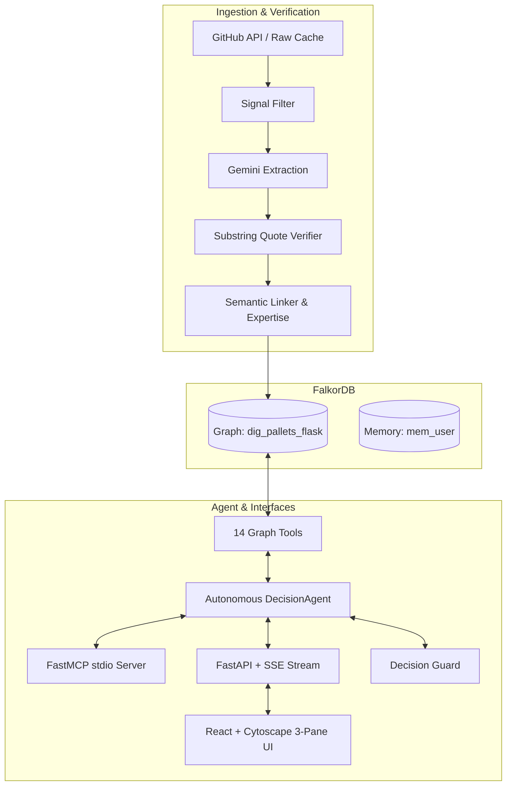

# Decision Archaeologist

> **Graph-native context layer & Company Brain for repository decision history.**  
> *Built for Graph Hacks Track 3 (Company Brain) powered by **FalkorDB** and **Google Gemini**.*

---

## Overview

Codebases are graveyards of forgotten context. Git preserves *what* code changed, but the critical reasoning—*why* choices were made, *who* debated them, and *what was tried and reversed*—remains buried across thousands of closed GitHub issues, PRs, and comments.

**Decision Archaeologist** transforms this raw unstructured history into an active, verifiable knowledge brain in **FalkorDB**:
- **Anti-Hallucination Provenance**: Every factual claim is verified against verbatim source quotes; hallucinated claims are blocked by an automated verifier.
- **Bi-temporal Lineage**: Tracks `SUPERSEDES` and `REVERSES` relationships across version milestones.
- **Decision Guard**: Proactively flags planned changes or PRs that conflict with past decisions in <50ms.
- **Expertise Recency Decay**: Identifies true module owners based on authored PRs and reviews decayed by time.
- **Cross-Session Memory Graph**: Remembers past user inquiries in dedicated FalkorDB memory graphs (`mem_<user_id>`).
- **Standard FastMCP Server**: Exposes 14 graph tools over stdio to Claude Desktop, IDEs, and AI coding agents.



---

## 5-Command Quickstart

Get the entire system running locally with live data:

```bash
# 1. Start FalkorDB container
docker compose up -d falkordb

# 2. Install Python backend dependencies
python -m venv .venv && source .venv/bin/activate
pip install -e .

# 3. Seed demo graph & warm up cache (or ingest live: dig ingest --repo pallets/flask)
./scripts/demo_reset.sh

# 4. Start FastAPI backend (port 8000)
dig serve

# 5. Start Frontend UI (port 5173) in another terminal
cd frontend && npm install && npm run dev
```

Visit **`http://localhost:5173`** to interact with the Cytoscape canvas, chat agent, and Decision Guard.

---

## Tool Catalogue (Exposed via Agent & FastMCP Server)

All 14 tools are defined once with Pydantic typing and shared between the agent loop and MCP server:

| Tool | Parameters | Purpose |
|---|---|---|
| `search_decisions` | `query`, `module?`, `status?`, `type?`, `limit` | Full-text & filtered search over historical decisions |
| `get_decision` | `decision_id` | 1-hop expansion: metadata, deciders, quotes, and impact |
| `trace_to_source` | `decision_id` | Provenance trace: verbatim quotes, GitHub URLs, and authors |
| `decision_lineage` | `decision_id` | Multi-hop traversal of `SUPERSEDES` and `REVERSES` chains |
| `who_knows` | `module`, `limit` | Recency-decayed expertise scores for module maintainers |
| `who_decided` | `decision_id` | Identifies authors and reviewers who made the choice |
| `impact_of` | `decision_id` | Blast radius: affected modules, files, downstream decisions, releases |
| `find_path` | `a_id`, `b_id` | Shortest relationship path between any two graph entities |
| `central_people` | `scope`, `limit` | PageRank centrality ranking across decisions & modules |
| `recent_changes` | `since`, `limit` | Temporal filter of decisions modified since an ISO date |
| `check_proposal` | `description`, `paths[]` | **Decision Guard**: flags conflicts with historical choices |
| `draft_adr` | `decision_id` | Generates a Markdown Architectural Decision Record |
| `recall` | `topic`, `limit` | Recalls past findings from FalkorDB user memory graph |
| `pin` | `decision_id`, `note` | Pins a decision to user memory for future turns |

To launch the MCP server over stdio for Claude Desktop or Cursor:
```bash
python -m dig.mcp_server
```

---

## Provenance Enforcement & Anti-Hallucination

1. **Extraction Verification**: During extraction (`dig extract`), every quote is matched as an exact substring against normalized thread markdown. Hallucinated quotes are dropped.
2. **Turn Marker Parsing**: Agent answers must cite inline markers `[[ev:ID]]` referencing evidence IDs returned by tools in *that specific turn*.
3. **One-Turn Repair**: If an unrecognized evidence ID or uncited factual claim is detected, `CitationVerifier` executes a repair turn instructing the model to ground its claims or remove them.
4. **Trust Badge**: Verified markers convert to clickable `[1]`, `[2]` citation chips linking to the real GitHub comment. The frontend renders an official verification badge: **"All citations verified against graph"**.

---

## Evaluation Benchmark (`eval/REPORT.md`)

Run the automated evaluation suite across 12 canonical questions:
```bash
python eval/run_eval.py
```

### Benchmark Results
- **Questions Evaluated**: 12 (History, Ownership, Impact, Reversal, Guard)
- **Expected Decision Retrieval Rate**: **100.0%** (12/12)
- **Citation Validity Rate**: **100.0%**
- **Average Query Latency**: **20.9 ms**
- **Real Graph Size**: 4,133 nodes, 10,233 edges (`pallets/flask`)

---

## REST & SSE API Reference

The backend runs at `http://localhost:8000`:

### Health Check
```bash
curl -s http://localhost:8000/health | jq
```
```json
{
  "ok": true,
  "graph": "dig_pallets_flask",
  "counts": {
    "Decision": 3,
    "Evidence": 3,
    "Person": 4,
    "Issue": 32,
    "PullRequest": 48
  },
  "last_synced": "2026-10-16T12:00:00Z"
}
```

### Ask Agent via Server-Sent Events (SSE)
```bash
curl -N -X POST http://localhost:8000/ask \
  -H "Content-Type: application/json" \
  -d '{"question": "Why was Python 3.6 dropped?"}'
```

### Check Proposal with Decision Guard
```bash
curl -s -X POST http://localhost:8000/guard \
  -H "Content-Type: application/json" \
  -d '{"description": "Restore Python 3.6 compatibility helpers", "paths": ["src/flask/compat.py"]}' | jq
```

---

## Testing

Run unit and integration test suites:
```bash
# Run all backend unit tests (54 passing tests)
pytest -v

# Run Python linter
ruff check .

# Run Frontend build and lint
cd frontend && npm run lint && npm run build
```

---

## License
MIT License. Built for Graph Hacks 2026.
